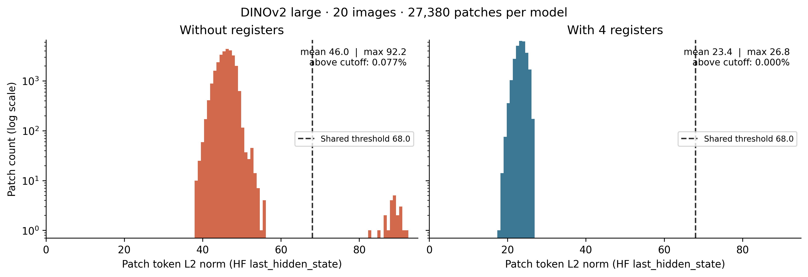
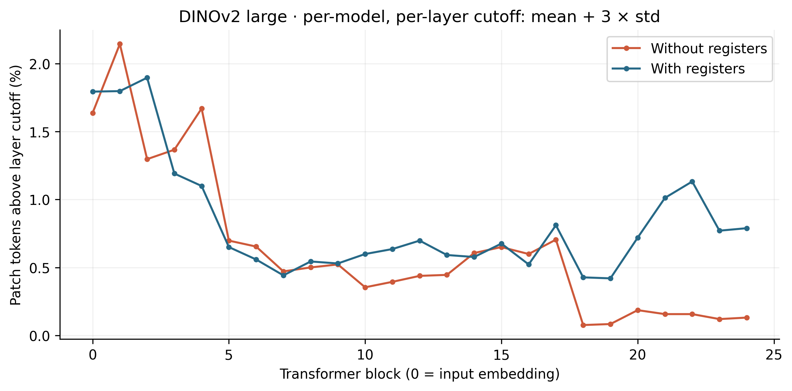
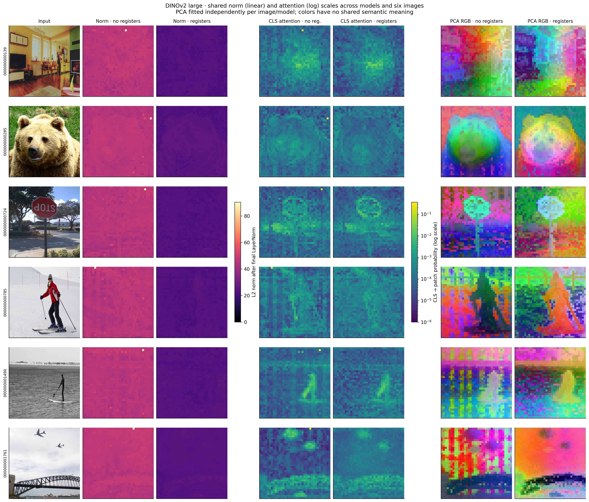

# Seeing ViT Registers

An independent inference reproduction on 20 COCO images finds a small, separated high-norm patch-token tail in DINOv2 Large without registers, and no such tail in the register model at the same cutoff.

[](https://colab.research.google.com/github/turhancan97/seeing-vit-registers/blob/main/notebook.ipynb)
[](LICENSE)

## Main comparison


Final normalized patch-token L2 norms, with the same color scale. The complete [six-image comparison](results/figures/visual_comparison_large.png) also includes CLS attention and PCA. Photo: COCO 000000000285; source and CC BY 2.0 license are listed in [images/SOURCES.md](images/SOURCES.md).

## What this repo does

This is a small, independent reproduction of the high-norm token observation in [*Vision Transformers Need Registers*](https://arxiv.org/abs/2309.16588). It compares the official Hugging Face DINOv2 Large and Base checkpoints, with and without four registers. It performs **no retraining**.

- **A:** combined final-patch norm histograms, summary statistics, and threshold sensitivity.
- **B:** layer-wise proportions above each model/layer's mean + 3 standard deviations.
- **C:** input images, norm maps, mean-head CLS attention, and PCA RGB features for six fixed examples.
- **Extras:** FeatLens cosine-to-seed and attention-rollout maps, neighboring-embedding similarity, and a COCO instance-mask background proxy.

## Quick start

Tested with **Python 3.12** and an NVIDIA A100 40 GB. A CUDA GPU is recommended; CPU execution is supported but substantially slower.

```bash
git clone https://github.com/turhancan97/seeing-vit-registers.git
cd seeing-vit-registers
python3.12 -m venv .venv
source .venv/bin/activate
python -m pip install -r requirements.txt
python scripts/run_all.py
```

The command downloads the 20 checksum-verified images, loads pinned checkpoint revisions, performs **fresh inference**, and regenerates all tables and figures in `results/`. It also writes `images/SOURCES.md`. Model downloads and JPEGs are ignored by Git. Initial model downloads need network access and several GB of disk space.

For Colab, open the badge, select a **GPU runtime**, and run all cells. The notebook clones the repository and installs `requirements.txt` when running in Colab. Local notebook users install the requirements first. The notebook only orchestrates `src/` functions and displays their results.

Useful optional commands:

```bash
python scripts/download_images.py                   # inputs + source/license list
python scripts/run_all.py --reuse                   # redraw using local feature arrays
python scripts/run_all.py --output-dir my-results   # separate output directory
```

`--reuse` requires feature arrays from a previous local run; they are intentionally not committed. It is never the default.

**Validation:** the CLI and the clean notebook both completed in a fresh Python 3.12 virtual environment installed solely from `requirements.txt`, with system/user site packages excluded. All four model outputs agreed with the original experiment, and all 15 PNGs / 14 PDFs passed validation. See the [recorded environment check](results/data/fresh_environment_validation.json). The notebook was tested locally in that isolated kernel; the Colab badge provides the hosted entry point.

## Results

These measurements use **`last_hidden_state`, after the learned final LayerNorm**, with **27,380 patch tokens per model**. The shared cutoff is **L2 > 68.01323582036801**.

| Model | Mean norm | Maximum norm | Above cutoff | Percentage |
|---|---:|---:|---:|---:|
| DINOv2 Large | 45.956 | 92.161 | 21 | 0.07670% |
| DINOv2 Large + 4 registers | 23.444 | 26.790 | 0 | 0% |
| DINOv2 Base | 48.631 | 58.353 | 0 | 0% |
| DINOv2 Base + 4 registers | 24.780 | 28.998 | 0 | 0% |

**The observed effect is smaller than the paper's giant-model example:** about twice the typical norm and roughly one outlier per image. We do not reproduce its illustrative 10× contrast or 2.37% outlier rate.

### A — Final patch-token norms



The no-register Large distribution has a gap from **55.7261 to 83.0095**; the cutoff is the geometric midpoint. The search considers percentiles 90–99.99, requires at least three samples above a candidate and an adjacent norm ratio of at least 1.2. This exploratory rule and the frozen cutoff are in `config.yaml`; the fresh run also records the re-estimated gap. Base has no clear separated mode and uses the Large cutoff for the common-scale comparison.

| Fixed cutoff | Large without registers | Large with registers | Either Base model |
|---|---:|---:|---:|
| 60 | 21 | 0 | 0 |
| 80 | 21 | 0 | 0 |
| 150 | 0 | 0 | 0 |

The original diagnostic cutoffs 100/150/200 also produce zero for all normalized outputs. Thresholds were selected after inspecting the scale, **not preregistered**. At **1.5× each model's own median**, the same 21 Large no-register patches are selected, with zero for the other models; the tail difference therefore persists after adjusting for overall feature scale.

### B — Across transformer layers



Each raw `output_hidden_states` stage uses its own pooled mean + **3× population std** (`ddof=0`). Layer 0 is the input embedding. **This plot does not reproduce a clean middle-layer onset or consistently lower register-model tail rates.** At the last raw Large block, the rates are **0.1315% without registers versus 0.7889% with registers**. This relative-tail statistic does not identify the same population as the final normalized-output cutoff.

Before final LayerNorm, Large mean/max norms are **96.373/132.908** without registers and **286.156/455.664** with registers. Raw residual-stream norms and normalized output norms are not interchangeable. Every forward verifies that applying the final LayerNorm to `hidden_states[-1]` reproduces `last_hidden_state`. See the [LayerNorm diagnostic](results/figures/layernorm_diagnostic_large.png).

### C — Spatial comparisons



The six inputs were chosen from the contact sheet before model outcomes. Norm maps share a linear color scale across both models and all six images. Attention and rollout use shared **logarithmic probability scales**, without per-image rescaling. PCA fits the first three full-SVD components independently per image/model; its colors are not aligned semantic labels.

**19/21 outliers (90.48%)** have centers outside annotated COCO objects, compared with **68.42%** of all patch centers. The outlier rate outside masks is **4.38×** the inside rate. This mask complement is a **background proxy**, not complete semantic background ground truth. Input-embedding neighbor cosine averages **0.880** for outliers versus **0.599** for other Large no-register patches.

More figures: [high-norm locations](results/figures/high_norm_locations_large.png), [FeatLens maps](results/figures/featlens_comparison_large.png), [proxy masks](results/figures/background_proxy_masks.png), and [Base comparison](results/figures/visual_comparison_base.png). Every main figure has a **300 dpi PNG and a PDF**.

## Settings

All scientific settings are in [`config.yaml`](config.yaml), including exact model revisions and image selection. URLs, licenses, and image SHA-256 hashes are in [`images/manifest.json`](images/manifest.json).

| Setting | Value |
|---|---|
| Models | `facebook/dinov2-{large,base}` and `facebook/dinov2-with-registers-{large,base}` |
| Input | 20 fixed COCO val2017 RGB images; bicubic squash-resize to 518×518; no crop |
| Normalization | ImageNet mean `[.485,.456,.406]`, std `[.229,.224,.225]` |
| Layout | CLS + 0/4 registers + **37×37 patch tokens**, asserted before reshaping |
| Seed / precision | 42; float32; eval + inference mode; deterministic algorithms; TF32 disabled |
| Attention | Eager implementation; all attention tensors and hidden states requested |
| Thresholds | Frozen gap cutoff 68.01323582036801; fixed 60/80/150; layer `k=3` |
| PCA / cosine | Full SVD; per-image/model RGB scaling; cosine seed at image center |
| Rollout | Original FeatLens kernels; mean heads; identity residual; full prefix transitions; no discarded edges |
| Original hardware | NVIDIA A100-SXM4-40GB; 8 CPU threads |
| Main package versions | torch 2.10.0, transformers 5.12.1, timm 1.0.25, numpy 2.1.3, matplotlib 3.10.8, scikit-learn 1.8.0 |

Both requested Large IDs loaded successfully; **no timm fallback was needed**. All four models run through Transformers. `requirements.txt` pins the recorded dependencies. Each run writes hardware/versions to `results/data/environment.json`, checkpoint information to `models.json`, source/configuration provenance to `run_provenance.json`, and artifact checks to `validation.json`.

Code layout:

```text
src/models.py       # pinned models, image preprocessing, CLS/register removal
src/norms.py        # experiments A/B and sensitivity tables
src/attention.py    # CLS attention, cosine, rollout
src/pca.py          # PCA RGB projections
src/plotting.py     # all publication figures
src/data.py         # verified downloads and attribution
src/location.py     # COCO background proxy
src/pipeline.py     # full orchestration
```

Compact CSV/JSON results are committed. Large `*.npz` feature arrays are regenerated locally; their schema is described in [results/data/README.md](results/data/README.md).

## Limitations

- **20 images, two sizes, one resolution, no retraining**, and no checkpoint/seed sweep.
- The fixed subset is not a representative benchmark. Patches within an image are correlated.
- The threshold is sample/checkpoint/feature-space dependent. Base's lack of a separated mode is not a universal guarantee.
- The raw-layer relative-tail metric does not reproduce the paper's clean onset story.
- COCO object-mask complements miss unlabeled foreground concepts. PCA and attention maps are descriptive, not segmentation ground truth or causal proof.
- Separately pretrained checkpoints do not isolate every training difference. Bitwise agreement across hardware and library builds is not guaranteed.
- Source photographs retain their original licenses; the repository's MIT license covers the code, not the photographs or pretrained weights. See [image sources](images/SOURCES.md) and [third-party notices](THIRD_PARTY_NOTICES.md).

## Related

- [Vision Transformers Need Registers — Darcet et al.](https://arxiv.org/abs/2309.16588)
- [Original DINOv2 implementation and checkpoints](https://github.com/facebookresearch/dinov2)
- [FeatLens](https://github.com/turhancan97/FeatLens), whose attributed cosine/rollout kernels are included at commit `07eddd718a5a53d11ca5cc21e69a21d0f7b9f2c3`.
- **Blog post: TODO** — add the Hugging Face post URL when published.

## Citation

Please cite the original paper:

```bibtex
@article{darcet2023vision,
  title   = {Vision Transformers Need Registers},
  author  = {Darcet, Timothée and Oquab, Maxime and Mairal, Julien and Bojanowski, Piotr},
  journal = {arXiv preprint arXiv:2309.16588},
  year    = {2023},
  doi     = {10.48550/arXiv.2309.16588}
}
```

To cite this independent reproduction, use [CITATION.cff](CITATION.cff) or:

```bibtex
@software{kargin2026seeing,
  author  = {Kargın, Turhan Can},
  title   = {Seeing ViT Registers: An Independent DINOv2 Reproduction},
  year    = {2026},
  version = {0.1.0},
  url     = {https://github.com/turhancan97/seeing-vit-registers}
}
```

## Acknowledgements

Thanks to Darcet et al. and the DINOv2 authors for the original research and public checkpoints; Hugging Face, PyTorch, and timm for model tooling; COCO contributors and the original photographers for the images and annotations; and FeatLens for the visualization kernels. This repository is an independent reproduction, not an official implementation by the paper's authors.
