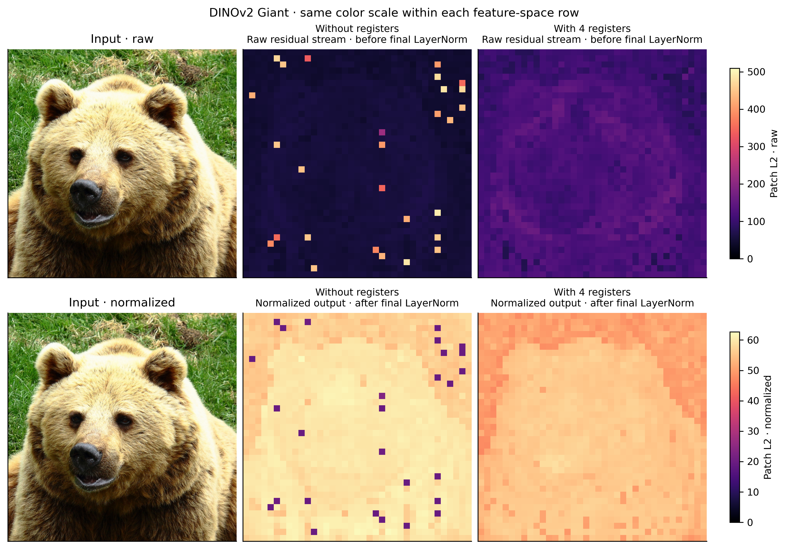
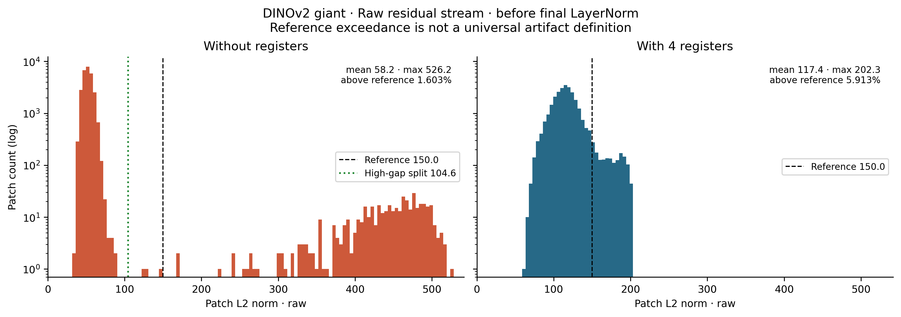
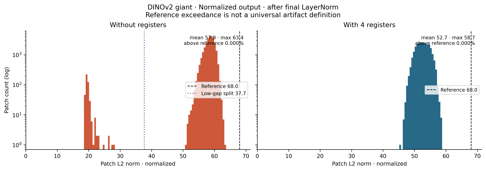
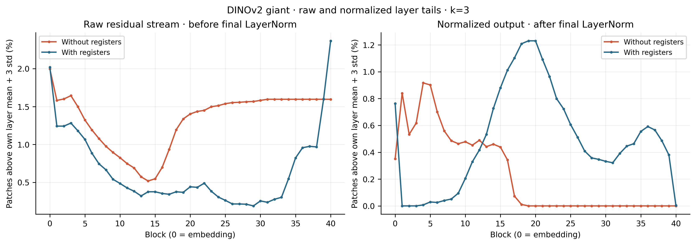
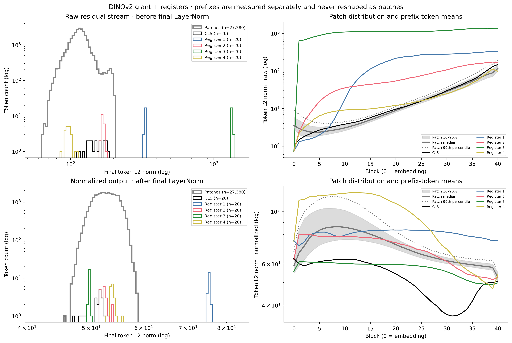
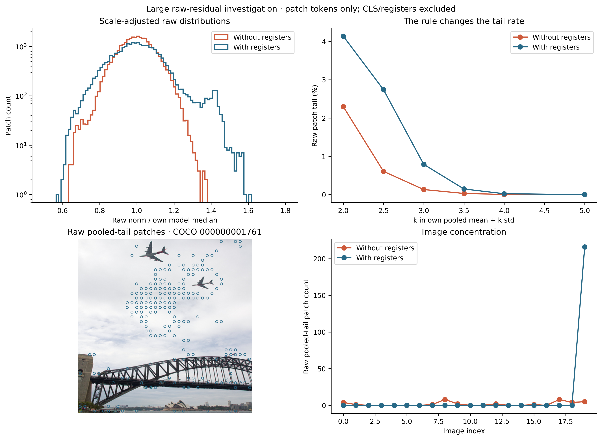
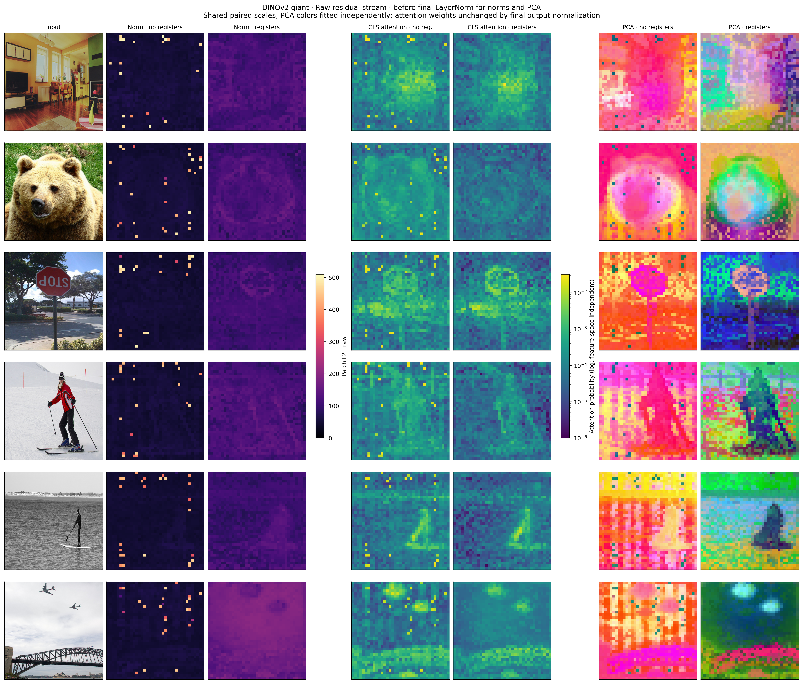

# Seeing ViT Registers

An independent inference study of Base, Large, and Giant DINOv2 shows that high-norm patch-token observations depend on both model size and whether features are measured before or after final LayerNorm.

[](https://colab.research.google.com/github/turhancan97/seeing-vit-registers/blob/main/notebook.ipynb)
[](LICENSE)

## Main comparison



> **Key takeaways**
>
> - **Feature space matters:** Giant has a raw maximum about **10.2× its patch median**; those high-norm patches become **low-norm spots** after final LayerNorm.
> - **Token type matters:** Giant with registers has no separated raw patch mode; one register's mean raw norm is about **1,346**, well above ordinary patches.
> - **A tail rate is not an artifact count:** all **216** Large register-model raw 3σ-tail patches come from one sky image; none exceed that image's own 3σ cutoff.

The same color scale is used within each row; raw and normalized rows have different scales. The fixed input is COCO 000000000285 ([source and CC BY 2.0 license](images/SOURCES.md)).

## What this repo does

This is an independent reproduction of the high-norm token observation in [*Vision Transformers Need Registers*](https://arxiv.org/abs/2309.16588), using **six official Hugging Face checkpoints, 20 fixed images, and no retraining**.

It reproduces norm histograms (A), layer-tail curves (B), and six-image norm/attention/PCA comparisons (C) **in both raw and normalized feature spaces**. It also measures CLS and all four register tokens at every layer, supplies FeatLens cosine/rollout maps, investigates the Large raw-tail reversal, and bootstraps outside-object fractions over images. See [methods and interpretation](docs/methods.md) for exact definitions.

## Quick start

Tested with Python 3.12 and an NVIDIA A100 40 GB. Giant float32 eager attention stores considerably more data than Base/Large; smaller Colab GPUs have not been validated.

```bash
git clone https://github.com/turhancan97/seeing-vit-registers.git
cd seeing-vit-registers
python3.12 -m venv .venv
source .venv/bin/activate
python -m pip install -r requirements.txt
python scripts/run_all.py
```

Git is required to install the pinned dependency. FeatLens is installed by pip from an exact Git commit in `requirements.txt`; its code is imported directly rather than copied into this repository.

The command verifies/downloads the same 20 images, performs **fresh inference** for all six pinned models, and regenerates tables and 300 dpi PNG/PDF figures. For Colab, open the badge, choose a GPU runtime with sufficient memory, and run all cells. The notebook installs requirements in Colab and only calls `src/` functions for the experiment.

```bash
python scripts/download_images.py                   # inputs and images/SOURCES.md
python scripts/run_all.py --reuse                   # redraw from compatible local arrays
python scripts/run_all.py --output-dir my-results   # separate output directory
```

Raw images, weights, and large NPZ feature arrays are excluded from Git. Exact settings are in [`config.yaml`](config.yaml); photo URLs/licenses/hashes are in [`images/SOURCES.md`](images/SOURCES.md) and its manifest.

## Results

Each model contributes **27,380 patch tokens**. CLS and registers are excluded from every patch statistic.

### Raw residual stream — before final LayerNorm

| Model | Mean | Maximum | Max / median | Own mean + 3σ tail | Separated gap? |
|---|---:|---:|---:|---:|---|
| Large | 96.37 | 132.91 | 1.38 | 0.1315% | No |
| Large + registers | 286.16 | 455.66 | 1.60 | 0.7889% | No |
| Base | 55.85 | 170.48 | 3.04 | 0.0110% | No |
| Base + registers | 141.45 | 209.43 | 1.49 | 0.4091% | No |
| Giant | 58.22 | 526.17 | 10.15 | 1.5961% | Yes |
| Giant + registers | 117.43 | 202.27 | 1.75 | 2.3667% | No |

The 3σ column is a **relative statistical tail, not an artifact count**. Giant without registers has **442 patches (1.61%)** above its observed raw gap cutoff **104.6**; **439 (1.60%)** exceed the separate fixed reference **150.0**. The register model has no separated raw patch mode, despite a higher ordinary raw scale. Absolute cutoffs do not transfer cleanly between models.



### Normalized output — after final LayerNorm

The historical **68.0** cutoff is retained for continuity. Full precision remains in the configuration.

| Model | Mean | Maximum | Patches > 68.0 | Percentage |
|---|---:|---:|---:|---:|
| Large | 45.96 | 92.16 | 21 | 0.07670% |
| Large + registers | 23.44 | 26.79 | 0 | 0.00000% |
| Base | 48.63 | 58.35 | 0 | 0.00000% |
| Base + registers | 24.78 | 29.00 | 0 | 0.00000% |
| Giant | 57.88 | 63.43 | 0 | 0.00000% |
| Giant + registers | 52.67 | 58.68 | 0 | 0.00000% |

**Change from the earlier README:** the original Large result (21 versus zero) is unchanged. The added Giant checkpoints reveal a much stronger **raw high-norm** effect. In Giant normalized outputs the signature reverses: **443 patches below 37.7 include all 442 raw-gap patches**; their median normalized norm is **19.5**, versus **58.6** elsewhere. The absence of a normalized high-norm tail does **not** mean the spatial artifacts vanish. The earlier small normalized Large contrast should therefore not be generalized to all sizes or feature spaces. This is a qualitative match to the paper's high-norm raw-token pattern, not an exact reproduction of its illustrative 2.37% rate.



### Across layers and prefix tokens





These plots distinguish raw hidden states from intermediate states passed through the model's learned final LayerNorm. Prefix plots show CLS and **each register separately**, next to patch distributions. Prefix norms are never counted as spatial artifacts. See equivalent [Large](results/figures/prefix_token_norms_large.png) and [Base](results/figures/prefix_token_norms_base.png) figures.

### Why Large's raw tail reverses

The pooled raw rule selects **36 patches (0.13%) without registers** and **216 (0.79%) with registers**. This is **not explained by overall multiplicative scale**: dividing by each model's median leaves these counts unchanged.

All 216 register-model patches are on COCO **000000001761** (airplanes, bridge, sky). They are a broad scene-specific group above the pooled cutoff **406.3**. That image's own cutoff is **459.2**, above its maximum **455.7**, and selects **zero**. None of the 36 raw no-register tail patches overlaps the 21 normalized-output outliers. Thus this reversal reflects the pooled rule and image mixture, **not evidence of more paper-style isolated artifacts with registers**. The underlying learned mechanism is not established by these measurements.



### Spatial comparisons and image-bootstrap uncertainty



Six examples were chosen before model outcomes. PCA is fitted independently per image/model; its colors are not shared semantic labels. Attention and rollout probabilities are independent of the displayed final feature space.

| Model / space / selection | Outside annotated objects | 95% image-bootstrap interval |
|---|---:|---:|
| Large without registers / normalized / >68.0 | 19/21 (90.5%) | 75.0–100.0% |
| Giant without registers / raw / observed gap >104.6 | 352/442 (79.6%) | 65.1–92.1% |
| Giant without registers / normalized / low gap <37.7 | 353/443 (79.7%) | 65.1–92.2% |

The bootstrap uses **1,000 whole-image resamples**, seed 42. These are pooled token fractions, not averages of per-image percentages. COCO object-mask complements are an imperfect background proxy; **68.4%** of all patch centers are outside objects. The intervals reflect substantial image-level uncertainty. No-outlier models have an **undefined** outside fraction/interval, not 0–0%.

More: [normalized Giant comparison](results/figures/visual_comparison_giant_normalized.png), [Large raw comparison](results/figures/visual_comparison_large_raw.png), [FeatLens Giant raw](results/figures/featlens_comparison_giant_raw.png), and [proxy masks](results/figures/background_proxy_masks.png).

## Settings

- Models: `facebook/dinov2-{base,large,giant}` and `facebook/dinov2-with-registers-{base,large,giant}`, all pinned by full revision in `config.yaml`; no timm fallback.
- Inputs: the same 20 COCO val2017 RGB images; bicubic squash-resize to 518×518; ImageNet normalization; **37×37** patch layout asserted.
- Seed 42; float32; eager attention; deterministic algorithms; TF32 disabled; frozen eval models; 8 CPU threads.
- Normalized reference **68.0**, raw scale reference **150.0**; fixed sensitivity cutoffs **60.0/80.0/150.0**; layer rule **mean + 3σ**. Exact values and gap-search settings remain in config.
- Original/test hardware: NVIDIA A100-SXM4-40GB. torch 2.10.0, transformers 5.12.1, timm 1.0.25, numpy 2.1.3, matplotlib 3.10.8, scikit-learn 1.8.0; all requirements remain pinned.

Full definitions, prefix tables, bootstrap handling and diagnostics are in [docs/methods.md](docs/methods.md). Output schemas are in [results/data/README.md](results/data/README.md); per-run hardware, source hashes, model revisions and validation are under `results/data/`.

## Limitations

**20 images, three sizes, one resolution, no retraining**, and no seed/checkpoint sweep. Patches within images are correlated. Thresholds and LayerNorm materially change interpretations; neither a 3σ tail nor a large absolute norm alone proves a repurposed token. COCO masks omit some foreground concepts. Separately pretrained checkpoints do not isolate every training difference. Cross-platform bitwise agreement is not guaranteed. Photos and image-containing figures retain their original terms; MIT covers the code, not photographs or weights.

## Related

- [Original paper — Darcet et al.](https://arxiv.org/abs/2309.16588)
- [DINOv2](https://github.com/facebookresearch/dinov2)
- [FeatLens](https://github.com/turhancan97/FeatLens), installed at commit `07eddd718a5a53d11ca5cc21e69a21d0f7b9f2c3` (v0.3.2), with the Hugging Face integration in [`src/attention.py`](src/attention.py) and [third-party notices](THIRD_PARTY_NOTICES.md).
- [Blog post — Seeing ViT Registers](https://huggingface.co/blog/turhancan97/seeing-vit-registers)

## Citation

Please cite the original paper:

```bibtex
@article{darcet2023vision,
  title   = {Vision Transformers Need Registers},
  author  = {Darcet, Timothée and Oquab, Maxime and Mairal, Julien and Bojanowski, Piotr},
  journal = {arXiv preprint arXiv:2309.16588},
  year    = {2023},
  doi     = {10.48550/arXiv.2309.16588}
}
```

To cite this independent reproduction, use [CITATION.cff](CITATION.cff) or:

```bibtex
@software{kargin2026seeing,
  author  = {Kargın, Turhan Can},
  title   = {Seeing ViT Registers: An Independent DINOv2 Reproduction},
  year    = {2026},
  version = {0.2.0},
  url     = {https://github.com/turhancan97/seeing-vit-registers}
}
```

## Acknowledgements

Thanks to Darcet et al. and the DINOv2 authors for the original research and public checkpoints; Hugging Face, PyTorch, and timm for model tooling; COCO contributors and the original photographers for the images and annotations; and FeatLens for the visualization kernels. This repository is an independent reproduction, not an official implementation by the paper's authors.
